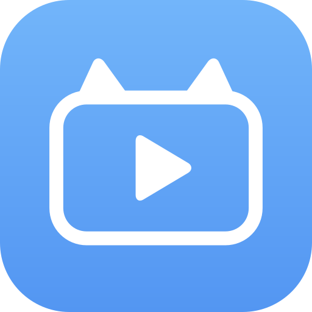

<p align="center">
  
</p>

# Neko Player

一款基于 **Jetpack Compose** 与 **Miuix** 构建的 Android 本地短视频播放器。选择视频目录即可上下滑动播放，支持本地收藏、后台播放，以及浅色、深色和跟随系统主题。

---

## ✨ 核心特性

* **滑动播放**：上下切换视频，相邻视频提前准备首帧并预读起始数据；支持顺序、随机与单视频循环。
* **未看优先**：随机播放时优先安排未看视频，可在设置中关闭；已看记录保存在本机。
* **缓存管理**：设置中查看播放缓存与预览图占用，支持清理，不影响原视频、收藏和已看记录。
* **本地收藏**：「首页／收藏」双标签与横向滑动对应，独立点赞按钮记录当前目录的视频收藏。
* **玻璃界面**：HyperOS 风格悬浮底栏、渐进模糊顶栏、玻璃主题菜单，以及简洁的设置与关于页。
* **主题切换**：浅色、深色、跟随系统三种模式，即时切换并保存选择。
* **播放控制**：支持全局或长按 2 倍速、画面裁切与原始比例、启动静音和音量键解除静音。
* **后台播放**：启用后支持系统媒体通知与锁屏控制，区分用户主动暂停与界面切换造成的暂停。
* **首次引导**：四步完成目录读取授权、路径选择和播放偏好设置；每次启动默认进入首页。

## 🛠️ 技术栈

* **播放引擎**：Media3 ExoPlayer + MediaSessionService
* **UI 框架**：Jetpack Compose
* **组件规范**：[Miuix](https://github.com/compose-miuix-ui/miuix) 0.9.4
* **玻璃效果**：[Backdrop](https://github.com/Kyant0/AndroidLiquidGlass) 2.0.0
* **系统要求**：Android 12 / API 31 及以上

播放器读取用户授权的本地目录，不上传视频。网络权限用于加载并缓存关于页中的 GitHub 头像。API 31–32 为部分玻璃效果提供兼容绘制；关于页在支持 MIUI 高级材质的系统使用原生透色效果，其它系统使用着色回退。

---

## 📜 版本历史

### v2.5.1

* **播放优化：** 上下切换视频时复用同一个渲染视图，相邻视频继续显示预载首帧；优先加载当前视频，避免后台预读争抢读取资源。
* **滑动体验：** 自动播放切换不再打断进行中的滑动，切换视频时减少重复播放器指令。
* **未看优先：** 新增随机播放偏好开关，默认开启；优先播放未看视频，全部看过后按普通随机顺序播放，观看过程中不重排列表。
* **本地记录：** 实际播放达到视频时长的一半、最多三秒后记为已看，支持倍速；预览、暂停和缓冲时间不计入，新记录不保存播放进度。
* **智能预载：** 根据滑动方向和连续翻页速度调整首帧预载顺序，快滑时优先准备落点附近的视频，滑动期间暂停额外播放数据预读。
* **缓存管理：** 设置中显示播放缓存和预览图占用，支持一键清理；系统内存紧张或界面退到后台时释放预览缓存。
* **长按反馈：** 长按加速触发时提供轻微震动，松手、滑动、触摸取消或离开播放页时恢复速度，减少手势冲突。

### v2.5.0

* **全新图标：** 蓝色渐变搭配白色猫耳视频框与播放键，支持自适应图标和系统单色主题。
* **播放重构：** 由媒体服务统一管理播放器，整合后台播放、媒体通知、锁屏控制和耳机断开暂停。
* **滑动预载：** 提前准备相邻视频首帧并预读起始数据，移除换源时的黑色渐显过渡。
* **首启引导：** 新增四页启动向导，完成目录授权、路径选择及自动播放、随机播放设置。
* **界面焕新：** 首页／收藏胶囊与独立点赞圆钮整体居中，设置和关于页隐藏播放控件，顶栏与底栏保持一致的玻璃材质。
* **主题模式：** 新增浅色、深色和跟随系统选项，主题菜单采用柔光玻璃弹出效果。
* **交互优化：** 播放页右上角进入设置，加速时左上角显示对称的玻璃「2×」提示；每次启动回到首页。
* **稳定性修复：** 完善暂停与恢复、收藏队列编辑、目录授权失效及损坏视频处理，并补充播放逻辑与界面测试。

### v2.2.0

* **交互进化：** 引入 Pager 滑动渐变动画，支持透明度与缩放动态过渡。
* **首帧秒开：** 新增 ExoPlayer 首帧渲染监听，通过首帧监听管理换源占位层。
* **稳定性修复：** 移除高危 `textureBlur` 递归捕获，解决 RenderThread 引起的 SIGSEGV 闪退。
* **环境跃升：** 适配 Android API 37 与 Miuix 最新标准，防烧屏机制持续生效。

### v2.0.0
* **视觉重构**：集成 `miuix-blur`，支持模糊强度与高度动态调节。
* **引擎升级**：切换至 `TextureView` 渲染，解决 Compose 兼容性导致的画面缺失。
* **布局自由**：新增标签水平/垂直边距调节，支持 UI 位置自定义。
* **交互优化**：设置面板限制为 75% 屏幕高度，支持边调边看的即时预览。
* **规范化**：按照 Miuix 标准重构设置页卡片布局。

### v1.5.0
* **设置面板**：新增中心化偏好管理入口。
* **播放控制**：支持随机播放、自动续播及单视频循环。
* **功能扩展**：新增后台音频播放、启动自动静音、画面比例切换 (Crop/Fit)。
* **倍速逻辑**：支持全局 2.0x 与长按倍速模式切换。
* **数据中心**：新增本地视频总量统计与收藏计数。
* **体验优化**：重构手势逻辑，解决滑动切换与长按倍速的交互冲突。

---

## 开发与验证

需要 JDK 21、Android SDK 37。Gradle Wrapper 已固定版本及校验和。

```bash
./gradlew :app:assembleDebug :app:testDebugUnitTest :app:lintDebug :app:assembleDebugAndroidTest
```

本地单元测试覆盖生命周期播放策略、相邻视频预读、列表排序、未看优先与已看判定、收藏顺序和队列编辑。界面测试覆盖首次引导、主题与播放偏好保存、玻璃菜单合成、导航与控件显隐、相邻视频预览及渲染视图复用等交互。

连接已授权的 API 31 以上设备后运行：

```bash
./gradlew :app:connectedDebugAndroidTest
```

编译界面测试不等同于真机测试通过。实际播放仍需在设备上验证目录授权、前后台切换、连续滑动、收藏变化、倍速、锁屏及损坏文件处理。

## Release 打包

Release 关闭调试，启用 R8 代码压缩和资源裁剪。通过环境变量提供发布签名：

* `NEKO_RELEASE_STORE_FILE`：签名库的绝对路径。
* `NEKO_RELEASE_STORE_PASSWORD`：签名库密码。
* `NEKO_RELEASE_KEY_ALIAS`：密钥别名。
* `NEKO_RELEASE_KEY_PASSWORD`：密钥密码。

```bash
./gradlew :app:assembleRelease :app:lintRelease
```

配置签名后，正式 APK 位于 `app/build/outputs/apk/release/app-release.apk`。未配置签名时生成未签名产物。私钥与密码应保存在仓库外，后续版本必须沿用同一签名才能覆盖升级。

## 致谢

界面组件由 [Miuix](https://github.com/compose-miuix-ui/miuix) 提供，玻璃效果由 [Backdrop](https://github.com/Kyant0/AndroidLiquidGlass) 提供。

第三方代码的版权声明、改编说明与许可证保存在 [app/src/main/assets/licenses](app/src/main/assets/licenses)，并随 APK 一同分发。
